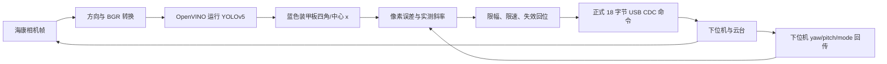

# 项目架构与源码地图：评定前先看懂这两条链

## 1. 总目标和当前实车版本

规则的完整自瞄是：相机看目标、算出它在空间中的位置和运动、预测弹丸到达时的位置、指挥云台、决定是否请求开火、观察命中反馈。你现在实车运行的程序只走到了其中的 **图像横向误差 → yaw 修正**。这一步有价值，因为相机、推理、正式协议和真实云台已经真正连起来，但它还不能代表 5 m 旋转靶的命中能力。

上图是 **截至 10 月 14 日已实际跑到的最小 yaw 闭环**，不包含 `Tracker`、`Solver` 的本车有效距离，也不包含 `Aimer` 弹道或射击。

## 2. 开源原项目与比赛适配入口是两回事

| 链条 | 入口与数据流 | 现在的状态 |
| --- | --- | --- |
| 开源原项目示例 | [`src/standard.cpp`](../../src/standard.cpp) 中 `Camera → YOLO → Tracker(内部调用 Solver) → Aimer → CBoard`。`CBoard` 用原队伍 CAN/控制板接口。 | 帮助理解完整自瞄的模块设计；这条入口**没有**直接按本次比赛 USB CDC 协议连接实车。 |
| 比赛现场逐步验证 | [`contest/live_pixel_probe.cpp`](../../contest/live_pixel_probe.cpp) 先只读相机与下位机；[`live_pixel_step_safe.cpp`](../../contest/live_pixel_step_safe.cpp) 做一次小步；[`live_pixel_follow_safe.cpp`](../../contest/live_pixel_follow_safe.cpp) 做受限的连续 yaw 修正。 | 已在车载电脑验证相机识别、协议收发、小步和受限连续修正；只控制 yaw、`fire_flag=0`。 |

项目来源：工作副本基于同济大学 SuperPower 战队开源 `sp_vision_25`，原项目的 `LICENSE` 为 MIT。比赛规则允许开源和预训练模型。你应把**开源基础**和**为比赛做的相机/通信/受限控制适配**分别介绍，不把原项目已写好的功能说成自己在本车上完成了验证。

## 3. 从 `main()` 往下读，按这个顺序打开文件

| 阅读顺序 | 真实文件与位置 | 这一处在做什么 | 你应能说出的答案 |
| --- | --- | --- | --- |
| 1 | [`src/standard.cpp`](../../src/standard.cpp)，`main` 约第 28 行、循环约第 59 行 | 原项目把模块串起来的示例入口。先 `camera.read`，再 `detector.detect`、`tracker.track`、`aimer.aim`、`cboard.send`。 | “这展示完整架构，但 `CBoard` 是旧接口，不能直接接比赛下位机。” |
| 2 | [`io/camera.cpp`](../../io/camera.cpp)，构造约第 11 行、`read` 约第 39 行 | 从 YAML 选择海康相机，读取曝光/增益，帧读出后按配置旋转 180°。 | “画面方向影响检测坐标；旋转在进入 YOLO 之前完成。” |
| 3 | [`io/hikrobot/hikrobot.cpp`](../../io/hikrobot/hikrobot.cpp) | 海康 SDK 的相机发现、取流、Bayer/RGB 到 BGR 转换。 | “颜色不对要先查相机像素格式，不是直接改模型标签。” |
| 4 | [`configs/live_yolo.yaml`](../../configs/live_yolo.yaml) | 现场识别配置：`camera_name: hikrobot`、`exposure_ms: 5`、`rotate_180: true`、`yolo_name: yolov5`、OpenVINO `device: CPU`、蓝色目标、阈值。 | “YAML 决定加载哪个模型和相机参数；其中内外参仍是演示值，不能用于本车精确测距。” |
| 5 | [`tasks/auto_aim/yolo.cpp`](../../tasks/auto_aim/yolo.cpp)，约第 11/33 行 | 按 YAML 名称创建 YOLOv5/8/11 实现，并转发 `detect()`。 | “这是接口选择器；真正的 YOLOv5 预处理和推理在 `yolos/yolov5.cpp`。” |
| 6 | [`tasks/auto_aim/yolos/yolov5.cpp`](../../tasks/auto_aim/yolos/yolov5.cpp)，构造约第 13、检测约第 57、解析约第 102 行 | 把图缩放到 640 输入，OpenVINO CPU 推理，解析类别/颜色/四角，再用 NMS 和置信度筛选。 | “OpenVINO 是运行模型的推理框架；YOLOv5 是模型与检测方法，两者不是同一个东西。” |
| 7 | [`tasks/auto_aim/armor.hpp`](../../tasks/auto_aim/armor.hpp)，`Armor` 第 80 行 | 一个候选装甲板的颜色、类别、中心、四角、置信度及后续 3D 字段。 | “绿色四角对应 `points`；当前跟随只用 `center.x`，还没用四角做本车 PnP。” |
| 8 | [`contest/protocol.hpp`](../../contest/protocol.hpp) 与 [`protocol.cpp`](../../contest/protocol.cpp) | 比赛报文的 18 字节编码与 30 字节反馈解析。 | “串口 `read` 是字节流，半帧、多帧都要缓存组帧；`fire_flag=0` 是明确不请求开火。” |
| 9 | [`contest/live_pixel_probe.cpp`](../../contest/live_pixel_probe.cpp)，`select_armor` 第 186 行、`main` 第 213 行 | 只读像素与角度同步观察。 | “斜率 +32.35 px/° 是用这里的 x/yaw 数据人工转动测得，不是网上找来的焦距。” |
| 10 | [`contest/pixel_step_policy.hpp`](../../contest/pixel_step_policy.hpp)、[`pixel_follow_policy.hpp`](../../contest/pixel_follow_policy.hpp) | 把像素误差变成小角度；限制单次/总角度。 | “`yaw_target = yaw_measured − error_px / slope`，然后限幅；pitch 暂时保持。” |
| 11 | [`contest/live_pixel_follow_safe.cpp`](../../contest/live_pixel_follow_safe.cpp)，串口类约第 108 行、目标选择约第 246 行、发送线程约第 273 行、`main` 约第 446 行 | 当前现场连续跟随入口：参数检查、只读/实机模式、数据新鲜度、状态切换、20 Hz 无弹指令和回位。 | “实机测试用的是这条受限链，而不是原项目 `standard` 入口。” |

`Tracker`、`Solver`、`Aimer` 暂时读**职责和接口**即可：[`tracker.cpp`](../../tasks/auto_aim/tracker.cpp) 做目标关联与状态机，内部调 [`solver.cpp`](../../tasks/auto_aim/solver.cpp) 的 `cv::solvePnP` 把四角转成相机坐标，再转云台/世界坐标；[`aimer.cpp`](../../tasks/auto_aim/aimer.cpp) 预测目标并迭代计算飞行时间、瞄准角。这些开源模块尚未用本车真实标定与有效弹速做完成验证。`solver.cpp` 仍用原项目 135/230 mm 装甲板宽度及 56 mm 灯条长度，不能直接代表本赛的 140×125 mm 靶标四个对应物理角点。

## 4. 当前现场入口，按执行顺序读

`live_pixel_follow_safe.cpp` 的 `main` 做这些事：

1. 解析参数。缺省只读；只有显式 `--actuate` 才打开串口写入。
2. 打开比赛串口、相机和 YOLO。相机输出已转正并是 BGR；YOLO 给出装甲板候选。
3. 只接受**单个、蓝色、置信度至少 0.8、有四个角点**的候选。无目标、多目标、图像/反馈过期时不继续跟随。
4. 取得起始 yaw/pitch，保持当前角度；等现场回传连续显示视觉档，才进入连续跟随。
5. 每帧计算 `target_x−图像中心`，按实测斜率得到 yaw 小修正。策略每次最多 `0.15°`，相对起点总共 `±2°`；发送线程每约 50 ms 最多改变 `0.05°`，pitch 保持，`fire_flag=0`。
6. 测试结束、目标丢失、超时或限位时发起回位，等待手动接管。相机循环超过 300 ms 未更新时，独立发送线程会锁定回位。若下位机回传或串口本身失效，自动回位不能被确认，必须由现场操作手切回手动档。

对评委说“这是一个受限的**静止靶 yaw 像素反馈实验**”。它没有根据四角算 5 m 距离，也没有纠正 pitch、估计旋转角速度或请求开火。**像素居中不等于弹丸命中**：镜头光轴、枪口轴线、弹道下坠与运动提前量还未标定和补偿。

## 5. 你读代码时先回答这三个问题

1. `camera.read(img, timestamp)` 的 `img` 进入 YOLO 前经过了哪两类修正？答案：海康像素格式转成 BGR、按配置旋转 180°。
2. `Armor` 的 `points` 和 `center.x` 有什么区别？答案：四角可供后续 PnP，当前小步控制只使用中心横坐标。
3. 为什么原项目的 `cboard.send(command)` 不能直接接本赛下位机？答案：原接口走其原队伍的 CAN/控制板数据，正式比赛要求 USB CDC 的 18/30 字节报文。
