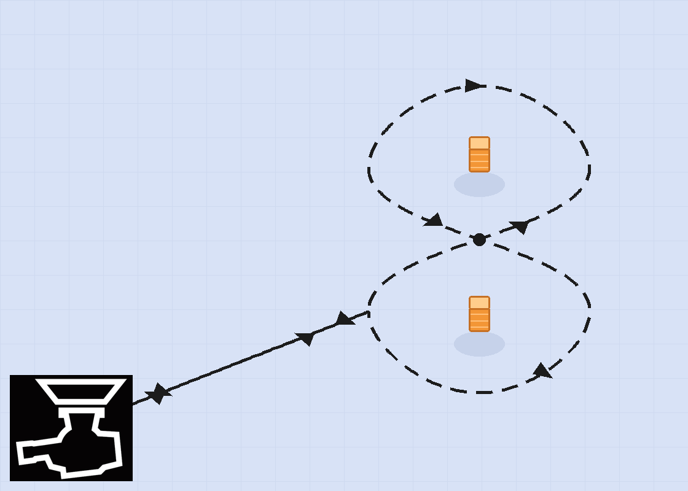

# 上海大学 SRM 战队算法校内赛规则书

**版本：** v1.0

**注意：** 本次校内赛的执行依据。未列明事项由赛务方统一解释；比赛期间赛务方可根据实际情况调整安排，调整以赛务最新通知为准。

## 1. 比赛概述

本次比赛设置导航赛道和自瞄赛道。两个赛道均提供可运行的实车，参赛者需要在规定时间内完成相应的算法、通信与整车控制闭环。

| 项目 | 已确认内容                                  |
| --- |----------------------------------------|
| 参赛形式 | 个人赛                                    |
| 赛道设置 | 算法组设导航赛道与自瞄赛道两个赛道                      |
| 报名范围 | 每人只能参加其中一个赛道，选定后不得更改                    |
| 参赛资格 | 报名已结束，已报名者均具备参赛资格                      |
| 比赛时间 | 9 月 26 日正式开始，10 月 17 日中期检查，10 月 31 日验收 |
| 比赛地点 | 待定（暂定 227 教室）；日常调试可前往 227 实验室及其走廊区域    |
| 场地与地图 | 导航场地与地图固定不变；允许提前扫图，也允许验收当场扫图           |
| 评分方式 | 两条赛道分开打分，由评委按实际效果评分                    |
| 评分构成 | 中期检查占 30%，最终验收占 70%；各评分项的具体分值另行公布      |
| 排名方式 | 两条赛道的成绩合并为一个总排名；成绩并列时并列排名              |
| 成绩公布 | 赛后 1 周内公布                              |
| 可使用的软件 | 开源项目、预训练模型、AI 辅助均允许，无需申报               |
| 队内既有代码 | 不允许使用；上下位机代码均不向参赛者提供，但提供通信协议内容         |
| 提交物 | 代码上传至 GitHub 仓库；验收现场仍可修改与调试            |

补充说明：

- 比赛期间不安排统一教学与集中指导，参赛者自行推进开发。
- 本规则书仅适用于本次校内赛。

## 2. 赛道与器材

### 2.1 导航赛道

- 任务：控制导航实车绕两根桩完成 8 字路线，路线见本节参考图。
- 传感器：Livox Mid-360 雷达（随车提供）。
- 计算设备：Intel NUC 小电脑；随车提供机器人 URDF。
- 评分关注点：完成 8 字路线的用时、在人为干扰下的避障表现等。

**参考图**（图片文件：`nav_exmple.png`）

**导航场地以实际场地为准。** 参考图只表示路线形状、行进方向与起终点关系，不代表实际尺寸、比例与桩的位置；场地大小、桩的位置与间距等一律以现场实际布置为准。

图上约定：

1. 起点与终点均为图左下角的停车位（装甲板贴纸处）。车辆从停车位沿直线驶入 8 字，绕行一圈后沿原路返回停车位。
2. 先绕下方的桩，再绕上方的桩；行进方向以图中箭头为准（下瓣逆时针、上瓣顺时针）。
3. 图中黑点为 8 字交叉点，位于两桩连线的中点。
4. 图中未设置固定障碍物，避障考核以人为干扰的形式进行；如现场增加障碍物，以现场实际布置为准。

### 2.2 自瞄赛道

- 任务：完成从目标检测、目标解算、云台瞄准到发射反馈的闭环。
- 相机：海康 CS016 工业相机。允许自带相机与补光灯；相机内参、外参由参赛者自行标定。
- 靶标：位于发射位 5 m 处、原地旋转的装甲板，尺寸 140 × 125 mm。
- 弹丸：17 mm 小弹丸，由赛务统一提供，不允许自带。
- 发射次数：每轮打完一个弹夹（50 发）。
- 有效发射和命中事件：由靶板传感器判定。
- 未发完处理：按已发完 50 发处理；命中率按固定 50 发计入分母。
- 零发射处理：本轮成绩记 0。
- 卡弹或供弹异常：允许在时限内修复后继续打完，不视为本轮结束。
- 开火条件：视觉开火请求与下位机火控允许必须同时满足，才允许开火。
- 评分指标：命中率占本赛道成绩的 75%，其余 25% 由评委按实际效果评分。

### 2.3 共用通信与器材

自瞄赛道使用 USB CDC 虚拟串口，协议见[《SRM 校内赛自瞄通信协议》](self_aim_protocol.md)；导航赛道使用 USB-UART 转接连接下位机 USART1，小电脑侧设备名约定为 `/dev/ttyACM*`，协议见[《SRM 校内赛导航通信协议》](navigation_protocol.md)。

- 参赛者只能使用现场提供的车辆、线缆与规定计算设备。
- 自瞄赛道允许自带相机与补光灯；**不允许对下位机相关内容做任何改动**。
- 导航赛道不允许改装车辆，也不允许加装任何传感器或结构件。
- 导航赛道的小电脑（Intel NUC）为共用设备，比赛与调试均使用同一台车与同一套器材。
- 小电脑环境由每人**单独创建个人用户**进行隔离：只在自己的用户环境内安装依赖、改配置，不要修改系统级设置，也不要改动其他参赛者的用户环境。

## 3. 自瞄赛道规则

### 3.1 比赛流程

1. 参赛者在检录区完成上位机和实车连接。
2. 赛前调试时间 5 分钟；裁判确认设备、软件版本和安全状态。
3. 裁判员下令开始后，参赛者在 1 分钟时限内完成检测、瞄准和发射。
4. 计时结束或裁判发出停止指令后，立即停止发射并等待裁判记录。
5. 每轮结束后由裁判员重置场地与器材。

### 3.2 计分

自瞄成绩以命中率为主：

`命中率 = 靶板传感器判定的有效命中数 ÷ 50`

`本赛道成绩 = 命中率 × 75% + 评委评分 × 25%`

- 有效发射和命中事件均由靶板传感器记录；未发完仍按 50 发计分，零发射记 0。
- 争议复核以现场录像为依据。
- 评委评分的具体维度与分值另行确定，不对外公布。

### 3.3 技术要求

参赛者负责上位机端的目标检测、目标跟踪/选择、弹道或瞄准解算、云台控制指令生成，以及与下位机的通信。

- 下位机固件、发射机构、安全急停均不可修改，由赛务方统一管理。
- 视觉控制由鼠标右键进入/退出，人工发射许可由鼠标左键给出，两者均由下位机实现。
- 弹速由裁判系统提供，机械限位由下位机保证，参赛者无需处理。
- 发射安全由比赛安全员统一控制；未获安全员许可不得发射。

### 3.4 自瞄通信接口（正式）

自瞄上位机必须使用[《SRM 校内赛自瞄通信协议》](self_aim_protocol.md)与下位机通信，该文档是本赛道的唯一通信协议来源。参赛者不得使用其他分支的旧版自瞄报文。

- 传输介质为 USB CDC 虚拟串口，Linux 设备名通常为 `/dev/ttyACM*`。
- 报文使用 2 字节小端 `body_len`，后接 ID 记录；协议不包含魔数、CRC、时间戳或序列号。
- 上位机到下位机的固定帧长为 18 字节：`body_len=16`，ID 1 携带 yaw/pitch，ID 2 携带 `fire_flag`。
- 下位机到上位机的固定帧长为 30 字节：`body_len=28`，ID 1 携带 yaw/pitch/roll/mode/color，ID 2 携带 `bullet_speed`。
- 所有整数和浮点数均为小端编码；USB 读取必须按长度字段进行流式缓存和组帧。
- `fire_flag` 只表示视觉侧开火请求，实际发射必须同时满足火控允许和人工许可。

## 4. 导航赛道规则

### 4.1 比赛流程

1. 参赛者在起点（参考图中的停车位）完成上位机、雷达和实车连接。
2. 裁判确认车辆处于安全待机状态，并清空上一轮运行数据。
3. 裁判发出开始指令后，车辆自动执行 8 字绕桩任务。
4. 车辆完成规定路线或触发终止条件后，记录本轮结果并返回起点。

- 本轮**不允许人工接管**：全程不得通过遥控器、键盘或其他方式干预车辆运动。
- 出现失控、冲出场地或其他不安全情况时，由裁判立即终止本轮。
- 本轮不设固定时限，只记录完成用时；未完成路线的，按实际完成情况记录。

### 4.2 计分

- 以完成 8 字路线的**总用时**为主要依据，用时越短越好。
- 在人为干扰下成功避障可以加分。
- 漏绕、碰桩、出界等情形的判定与扣分办法由评委按现场表现评定。

### 4.3 通信与控制接口

- 上位机与下位机之间的协议见[《SRM 校内赛导航通信协议》](navigation_protocol.md)，该文档是本赛道的唯一通信协议来源。
- `vx`、`vy` 不是真实速度值，与底盘实际速度成正比关系；`wz` 当前不生效，协议保留该字段。
- 指令发送频率按协议文档的要求执行（固定频率单帧发送，推荐 100 Hz）。
- 只向参赛者提供协议文档；下位机固件与参考实现均不提供。

## 5. 公平性与安全

- 所有参赛者使用同一赛道规则、同一批次现场器材和同一套评分口径。
- 允许使用开源项目、预训练模型和 AI 辅助工具，无需申报来源。
- 禁止使用 SRM 队内既有代码；上下位机代码均不向参赛者提供。代码检查以参赛者上传至 GitHub 的代码与实际运行效果为依据。
- 迟到者扣分；缺赛、退赛按放弃处理，不予补赛。
- 抄袭他人代码（未经他人同意）取消验收资格；故意损坏实验室设备须照价赔偿。
- 任何可能造成人员伤害、车辆失控、误发射或设备损坏的情况，裁判组有权立即终止运行。
- 自瞄赛道的发射安全（安全距离、靶场隔离、急停与发射许可）由比赛安全员统一控制；未获安全员许可不得发射。
- 因参赛者原因造成的设备损坏，由参赛者赔偿；因赛务方设备故障导致的运行中断，验收暂停并另行安排。
- 上位机故障由参赛者在限定时间内自行修复；未能修复的，本轮视为失败。

## 6. 通信协议

- 自瞄赛道：以第 3.4 节及[《SRM 校内赛自瞄通信协议》](self_aim_protocol.md)为准。最终协议来源为 `infantry_leg&prostrate` 分支，参考提交 `f7b83a58e8dc8af13ae5f328687c2fd7462e8b80`；`hero_rabbit_ZEG` 仅作为历史参考，不作为本次比赛的协议来源。
- 导航赛道：以[《SRM 校内赛导航通信协议》](navigation_protocol.md)为准。链路为小电脑 `/dev/ttyACM*` → USB-UART 转接 → 下位机 USART1，串口参数 115200 baud、8 数据位、无校验、1 停止位。
- 两个方向的帧结构不同，参赛者不得把自瞄赛道的报文格式用于导航赛道，反之亦然。
- 协议文档之外的固件源码、参考实现与历史分支均不提供给参赛者。

